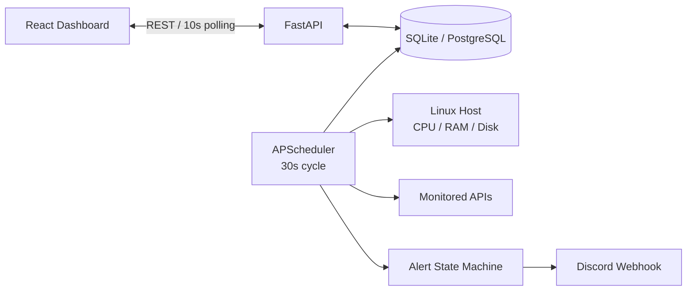

# Automated Linux Server & API Health Monitoring System

[](https://fastapi.tiangolo.com)
[](https://react.dev)
[](https://vitejs.dev)
[](https://www.postgresql.org)
[](https://www.docker.com)


A full-stack observability application for monitoring Linux host resources and
HTTP/HTTPS API availability. It samples CPU, memory, and disk usage, runs
concurrent synthetic API probes, stores telemetry in SQLite or PostgreSQL, and
sends deduplicated alerts to Discord.

The backend runs locally with zero configuration using SQLite. A Docker Compose
stack is included for PostgreSQL 15, FastAPI, and an Nginx-served React build.

---

## Features

- **Host telemetry** — CPU, memory, and root disk usage collected with `psutil`
  every 30 seconds.
- **Concurrent API probes** — HTTP/HTTPS checks with `httpx.AsyncClient`, a
  5-second timeout, redirect support, and per-endpoint latency tracking.
- **Uptime calculation** — uptime percentage derived from recorded probe
  history for each endpoint.
- **Alert deduplication** — a state machine sends one alert when an incident
  starts, one on severity change, and one when it resolves.
- **Discord notifications** — color-coded embeds; alerts fall back to console
  logging when no webhook is configured.
- **Dashboard** — React UI with KPI cards, a live CPU/memory chart, endpoint
  management, uptime bars, and an incident feed.
- **Deployment and tests** — Docker Compose, Nginx, GitHub Actions, and a
  five-test pytest suite.

---

## Architecture



Every 30 seconds the scheduler collects host metrics and probes all active
endpoints concurrently. Results are committed to the database. When a threshold
or availability state changes, an incident is recorded and a notification is
dispatched once.

---

## Tech Stack

| Layer | Technologies |
| :--- | :--- |
| Backend | Python 3.12, FastAPI, Uvicorn, Pydantic 2, SQLAlchemy 2 |
| Monitoring | APScheduler, psutil, httpx |
| Database | SQLite (default), PostgreSQL 15 (Docker) |
| Frontend | React 18.3.1, Vite 5.4.21, Tailwind CSS 3.4.17, Recharts |
| Delivery | Docker Compose, Nginx 1.25, GitHub Actions |
| Testing | pytest, FastAPI TestClient |

> The frontend includes a `yarn.lock`; Yarn is recommended for local installs.
> The Dockerfile and CI currently use npm. Standardize on one package manager
> before a production release.

---

## Project Structure

```text
.
├── backend/
│   ├── app/
│   │   ├── main.py        # FastAPI app and lifespan
│   │   ├── routes.py      # REST API routes
│   │   ├── monitor.py     # Scheduler, psutil telemetry, httpx probes
│   │   ├── alerts.py      # Discord webhook and alert state tracker
│   │   ├── models.py      # SQLAlchemy models
│   │   ├── schemas.py     # Pydantic schemas
│   │   └── database.py    # Engine and session management
│   └── tests/test_api.py  # API tests
├── frontend/
│   ├── src/
│   │   ├── components/    # Header, KPIs, chart, endpoints, incidents
│   │   ├── App.jsx        # Dashboard state and polling
│   │   └── api.js         # Centralized fetch client
│   ├── Dockerfile
│   └── nginx.conf
├── .github/workflows/ci.yml
├── docker-compose.yml
└── README.md
```

---

## Getting Started

### Prerequisites

- Python 3.10+ (3.12 recommended)
- Node.js 18+ (20 LTS recommended)
- Yarn 1.22+ or npm 10+
- Docker and Docker Compose (optional)

### Backend

```bash
cd backend
python3 -m venv venv
source venv/bin/activate
pip install -r requirements.txt
cp .env.example .env
uvicorn app.main:app --host 0.0.0.0 --port 8000 --reload
```

The backend creates `monitor.db` automatically and seeds three default
endpoints if the table is empty.

- API: http://localhost:8000
- Swagger UI: http://localhost:8000/docs

### Frontend

```bash
cd frontend
cp .env.example .env
yarn install
yarn dev
```

Open http://localhost:5173. The npm alternative is `npm install && npm run dev`.

### Docker Compose

```bash
# Optional: enable Discord alerts
echo "DISCORD_WEBHOOK_URL=https://discord.com/api/webhooks/..." > .env

docker-compose up -d --build
```

| Service | URL |
| :--- | :--- |
| Dashboard | http://localhost:5173 |
| API / Swagger | http://localhost:8000/docs |
| PostgreSQL | `localhost:5432` (user/password: `postgres`) |

To stop the stack, run `docker-compose down`. Add `-v` to remove the database
volume as well.

---

## Configuration

| Variable | Service | Default | Description |
| :--- | :--- | :--- | :--- |
| `DATABASE_URL` | Backend | `sqlite:///./monitor.db` | SQLite locally; PostgreSQL in Docker |
| `DISCORD_WEBHOOK_URL` | Backend | empty | Optional Discord alert webhook |
| `VITE_API_URL` | Frontend | `http://localhost:8000` | Backend base URL (set at build time) |

---

## API Reference

| Method | Endpoint | Description |
| :--- | :--- | :--- |
| `GET` | `/api/health` | Service health, scheduler state, database connectivity |
| `GET` | `/api/metrics/latest` | Latest host metrics and the last 25 samples |
| `GET` | `/api/endpoints` | Endpoints with status, latency, and uptime |
| `POST` | `/api/endpoints` | Register an endpoint |
| `DELETE` | `/api/endpoints/{id}` | Delete an endpoint and its check history |
| `GET` | `/api/incidents` | Latest 30 incidents, newest first |
| `POST` | `/api/monitor/trigger` | Run an immediate monitoring cycle |

Example:

```bash
curl -X POST http://localhost:8000/api/monitor/trigger
```

---

## Monitoring and Alerting

The monitoring cycle runs every 30 seconds with single-flight scheduling
(`max_instances=1`, `coalesce=True`). All endpoints are probed concurrently and
a failed probe does not interrupt the remaining checks.

| Condition | Severity | Behavior |
| :--- | :--- | :--- |
| CPU or memory above 85% | `WARNING` | Alert once when the threshold is breached |
| CPU or memory above 95% | `CRITICAL` | Alert once on escalation |
| API returns HTTP 400+ or times out | `CRITICAL` | Alert once when the endpoint goes down |
| Resource normalizes or API recovers | `RESOLVED` | Alert once on recovery |

Repeated alerts for an unchanged state are suppressed. Alert state is kept in
memory, so it is reset when the backend restarts.

---

## Testing

```bash
cd backend
source venv/bin/activate
pytest tests/ -v
```

The suite uses an isolated in-memory SQLite database. Current result: **5 tests
passing**.

```bash
cd frontend
yarn build
```

The Vite production build succeeds. Vite reports a chunk-size warning for the
main bundle, which is a known optimization item.

---

## Operational Notes

- The application monitors only the host where the backend runs.
- There is no authentication or authorization. Do not expose the API publicly
  without adding access control.
- Uptime is calculated over all recorded checks, not a rolling time window.
- Disk usage is recorded but currently has no alert threshold.
- CPU and memory thresholds are fixed at 85% and 95%.
- Probe and webhook failures are not retried.
- SQLite is suitable for local use; PostgreSQL is recommended for production.
- The API accepts any HTTP/HTTPS URL, so SSRF protection should be added before
  allowing untrusted users to register endpoints.

---

## License

This project is licensed under the [MIT License](LICENSE).
